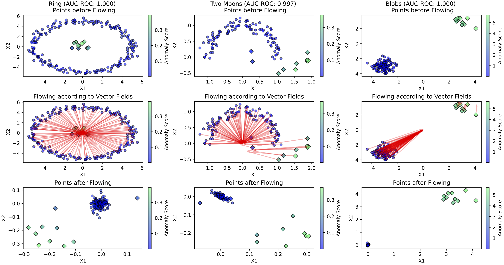

# TCCM: Scalable, Explainable and Provably Robust Anomaly Detection with One-Step Flow Matching

[](https://openreview.net/forum?id=jDYuadVajk)
[](https://arxiv.org/abs/2510.18328)
[](https://creativecommons.org/licenses/by-sa/4.0/)
[](https://www.python.org/)
[](https://www.linux.org/)
[](https://visitorbadge.io/status?path=ZhongLIFR%2FTCCM-NIPS)

This is the official repository for the **NeurIPS 2025** paper:

> **Scalable, Explainable and Provably Robust Anomaly Detection with One-Step Flow Matching**  
> [OpenReview](https://openreview.net/forum?id=jDYuadVajk) | [arXiv](https://arxiv.org/abs/2510.18328)

TCCM, short for **Time-Conditioned Contraction Matching**, is a one-step flow-matching framework for semi-supervised anomaly detection in tabular data. Instead of using iterative sampling or ODE-based inference, TCCM learns a time-conditioned contraction field that pulls data toward a fixed normal target and scores anomalies through a single forward-pass deviation measure.

The method is designed around three practical goals: scalable inference, feature-level explainability, and robustness under bounded perturbations. The paper evaluates TCCM on the ADBench benchmark suite and includes additional ablation, empirical robustness, and contaminated-training studies.

<p align="center">
  
</p>

---

## Highlights

- **One-step anomaly scoring**: TCCM uses a one time-step deviation score, avoiding costly iterative inference used by many continuous-time generative models.
- **Feature-wise explanations**: Because the learned contraction field operates directly in input space, the anomaly score can be decomposed into feature-level contributions.
- **Provable robustness**: The score function is analyzed through Lipschitz continuity, giving guarantees under small bounded perturbations.
- **Large-scale empirical evaluation**: The paper benchmarks TCCM against a broad set of anomaly detection baselines on ADBench datasets, with particular gains on high-dimensional and large-scale settings.
- **Reproducible experiments**: This repository contains scripts for the main benchmark, inductive-mode checks, ablations, empirical robustness verification, and contamination robustness.

---

## Method Overview

TCCM models anomaly detection as a contraction problem. During training, the model learns a time-conditioned vector field that predicts how samples should contract toward a normal reference target. At inference time, each sample is scored by how much its observed contraction behavior deviates from the expected normal contraction pattern.

This design gives TCCM a compact inference pipeline:

1. Pass a sample through the trained contraction model once.
2. Compute its one time-step deviation score.
3. Use the deviation magnitude for anomaly ranking and its feature-wise components for explanation.

Compared with heavier continuous-time models, this removes the need to solve ODEs during training or inference while retaining the geometric intuition of flow matching.

---

## Benchmark Summary

The paper evaluates TCCM on the ADBench tabular anomaly detection benchmark and compares it with a broad collection of classical, deep, and generative baselines. The experiments report AUROC and AUPRC, computational cost, ablation behavior, adversarial robustness, and robustness under contaminated training data.

In the paper, the datasets are organized into four groups:

- `small`
- `medium`
- `high_dim`
- `large`

This grouping is also used by the reproduction scripts in this repository.

---

## Updates

- **2026.05.11**: Repository README updated with the official OpenReview citation and reproduction instructions.
- **2025.09.18**: Paper accepted to the Thirty-ninth Annual Conference on Neural Information Processing Systems.
- **2025.10.22**: arXiv version released: [arXiv:2510.18328](https://arxiv.org/abs/2510.18328).

---

## Repository Structure

```text
TCCM-NIPS/
├── FMAD/                     # TCCM / FMAD implementation components
├── baselines/                # Baseline anomaly detection methods
├── bash_files/               # Reproduction scripts
├── datasets/                 # ADBench datasets
├── AblationStudies.py        # Ablation study runner
├── AggregateResults.py       # Result aggregation script
├── ContaminationStudies.py   # Contamination robustness experiments
├── FullExperiments.py        # Main benchmark experiments
├── ProcessContamination.py   # Contamination-result processing
├── RobustnessStudy.py        # Empirical robustness verification
├── requirements.txt          # Python dependencies
└── utils.py                  # Utility functions
```

---

## Reproduction Roadmap

| Goal | Command / Script | Main Output |
| --- | --- | --- |
| Main AUROC / AUPRC benchmark | `./bash_files/run_main.sh` | `./results_all`, `./logs` |
| Inductive-mode reviewer check | `./bash_files/run_semisupervise.sh` | `./results_all` |
| Aggregate benchmark results | `python AggregateResults.py --semi_only` | `Rank_ROC.pdf`, `Rank_PR.pdf`, `./final_metrics/all` |
| Ablation studies | `python AblationStudies.py` | `./results_ablation` |
| Empirical robustness verification | `./bash_files/run_robustness.sh` | `./results_robustness` |
| Contamination robustness | `./bash_files/run_contamination.sh` and `python ProcessContamination.py` | `./results_contam` |

---

## Setup

The codebase was developed with **Python 3.9.21** and tested on **Linux**.

1. Clone the repository:

```bash
git clone https://github.com/ZhongLIFR/TCCM-NIPS.git
cd TCCM-NIPS
```

2. Install dependencies:

```bash
pip install -r requirements.txt
```

---

## Datasets

The ADBench datasets used in the paper are placed under:

```text
./datasets
```

The datasets are grouped into four categories:

- `small`
- `medium`
- `high_dim`
- `large`

These categories correspond to Table 1 in the paper.

---

## Reproducing Main Results

To reproduce the benchmark results in Figure 2 (AUROC and AUPRC), run the following commands from the repository root:

```bash
chmod u+x ./bash_files/run_main.sh
./bash_files/run_main.sh
```

Logs are stored under:

```text
./logs/seed_$RANDOM_SEED/run_{dataset_ID_NAME}_model_{model_ID}.log
```

Once all runs are complete, the following message will appear at the end of:

```text
./logs/All_log.log
```

```text
LARGE datasets processed.
```

---

## Additional Inductive-Mode Experiments

As requested during review, we also performed additional experiments enforcing transductive models to behave inductively.

Run:

```bash
chmod u+x ./bash_files/run_semisupervise.sh
./bash_files/run_semisupervise.sh
```

All experimental results are saved under:

```text
./results_all
```

---

## Result Aggregation and Visualization

To aggregate results:

```bash
python AggregateResults.py --semi_only
```

Remove the `--semi_only` flag if you would like transductive models to run in their standard mode.

The AUROC and AUPRC plots are saved as:

```text
Rank_ROC.pdf
Rank_PR.pdf
```

Dataset-wise tabular results and model rankings are saved under:

```text
./final_metrics/all
```

---

## Notes on Running the Benchmark

- All experiment runs are executed on CPU only.
- For each dataset, each algorithm is allowed at most **10 GB RAM** and **3 days** runtime.
- You can change `MEMORY_LIMIT` and `TIME_LIMIT` in `run_everything.sh`.
- By default, the scripts run `45 x (K = 3) = 135` jobs in parallel. Please adjust `K` as needed.
- By default, the experiments are executed on all datasets for all models, which may take a long time.
- Numerical results may differ slightly from the paper due to CPU-level randomness, but we verified the results on two different clusters and observed consistent overall model rankings.

---

## Ablation Studies

To reproduce the ablation studies in Appendix D.3, run:

```bash
python AblationStudies.py
```

The resulting plots are saved under:

```text
./results_ablation
```

Expected outputs include:

- `Time_Embedding_Figure_12.pdf`: time embedding variants used in TCCM
- `Sensitivity_t_Figure_13.pdf`: sensitivity to fixed inference time `t`
- `Noise_Injection_Figure_14.pdf`: effect of noise injection during training
- `Contamination_Figure_TCCM.pdf`: effect of contamination in training data

---

## Empirical Robustness Verification

To reproduce the empirical robustness verification experiments in Appendix D.4, run:

```bash
chmod u+x ./bash_files/run_robustness.sh
./bash_files/run_robustness.sh
```

The raw results and plots are saved under:

```text
./results_robustness
```

Expected outputs include:

- `combined_FP_False.pdf`: false negative attack, making anomaly samples appear normal
- `combined_FP_True.pdf`: false positive attack, making normal samples appear anomalous

---

## Robustness Under Contaminated Training Data

To reproduce the contamination robustness experiments for the top-10 performing models, run:

```bash
chmod u+x ./bash_files/run_contamination.sh
./bash_files/run_contamination.sh
python ProcessContamination.py
```

The raw data, CSV tables, and plots are saved under:

```text
./results_contam
```

---

## Citation

If you find this repository useful, please cite our paper:

```bibtex
@inproceedings{
li2025scalable,
  title={Scalable, Explainable and Provably Robust Anomaly Detection with One-Step Flow Matching},
  author={Zhong Li and Qi Huang and Yuxuan Zhu and Lincen Yang and Mohammad Mohammadi Amiri and Niki van Stein and Matthijs van Leeuwen},
  booktitle={The Thirty-ninth Annual Conference on Neural Information Processing Systems},
  year={2025},
  url={https://openreview.net/forum?id=jDYuadVajk}
}
```

---

## License

This repository is released under the **CC BY-SA 4.0** license.

---

## Contact

For questions, bug reports, or suggestions, please open an issue in this repository.
